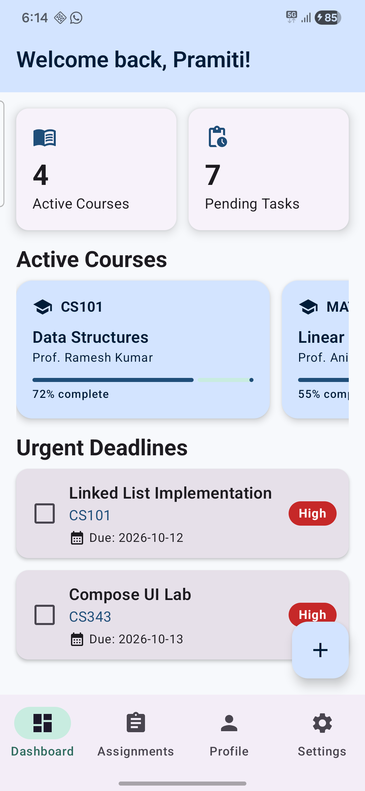
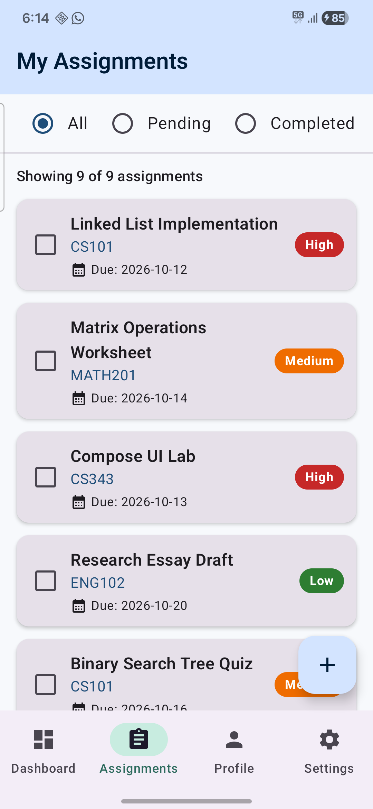
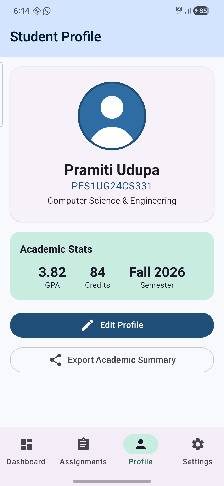
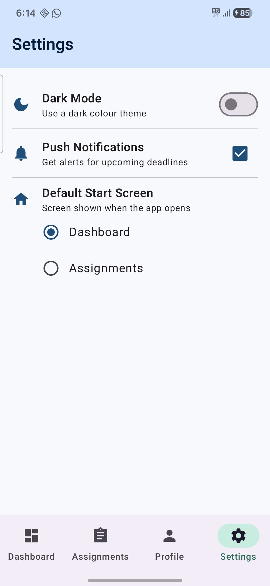
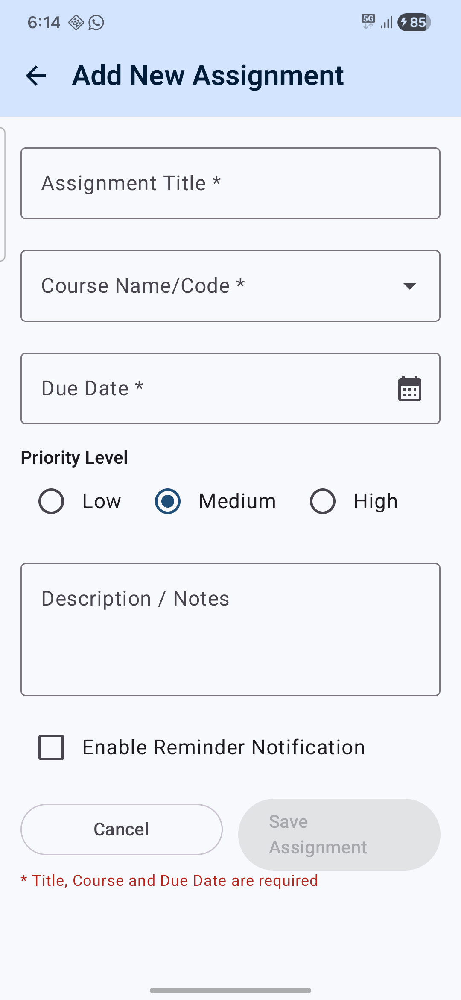
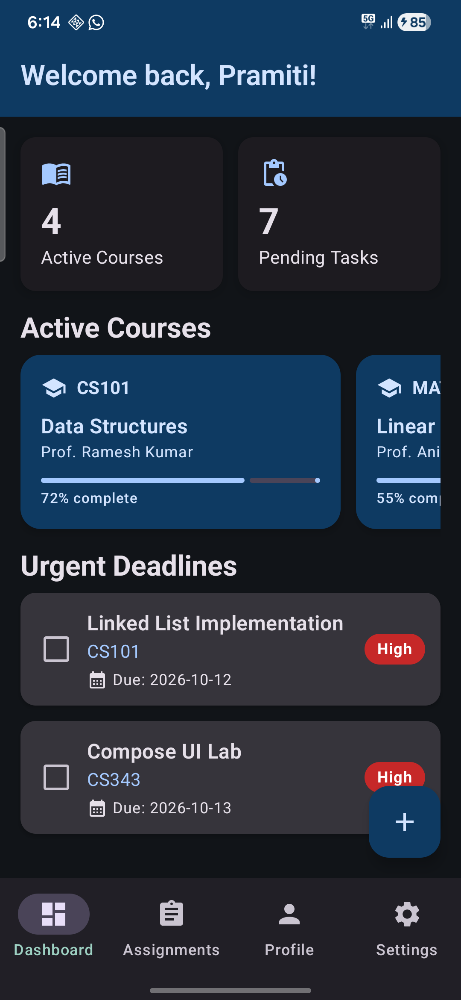

# Student Organizer App

**Modern Android App Development with Kotlin (UE24CS343AB4) – Level 2 Assignment**
Pramiti Udupa · PES1UG24CS331

A 5-screen Student Organizer built with **Jetpack Compose**, **custom composables**, **state hoisting**, **form validation** and **Compose Navigation** (`NavHostController`, `NavHost`, sealed-class routes). There is no database or network; all data is UI state and sample data models, as the assignment specifies.

| Dashboard | Assignments | Profile | Settings | Add Assignment | Dark mode |
|---|---|---|---|---|---|
|  |  |  |  |  |  |

## Screens & routes
| Route | Screen | Reached by |
|---|---|---|
| `dashboard` | DashboardScreen | Start destination / BottomBar |
| `assignments` | AssignmentsScreen | BottomBar |
| `profile` | ProfileScreen | BottomBar |
| `settings` | SettingsScreen | BottomBar |
| `add_assignment` | AddAssignmentScreen | '+' FAB on Dashboard or Assignments; back arrow returns |

## Custom composables
`AppBar` · `BottomBar` · `CourseInfo` · `AssignmentCard` · `StudentProfile` · `AssignmentForm` (stateless, state-hoisted, with an `actions` slot)

## Features
- Dashboard: greeting, live stat cards (courses / pending tasks), `LazyRow` of courses, top-2 urgent deadlines
- Assignments: All / Pending / Completed radio filter, `LazyColumn` with completion checkboxes
- Add Assignment: 6 form fields; **Save disabled until Title, Course and Due Date are filled**; BottomBar hidden
- Profile: student header, academic stats, Edit Profile dialog, Export Academic Summary (share intent)
- Settings: working Dark Mode switch, notifications checkbox, default start screen radio group

## Project structure
```
app/src/main/java/com/pes/studentorganizer/
├── MainActivity.kt          entry point, dark-mode state, lifecycle logs
├── StudentOrganizerApp.kt   NavController + Scaffold + NavHost + shared state
├── navigation/Screen.kt     sealed class Screen(val route: String)
├── model/Models.kt          data classes + sample data
├── components/              AppBar, BottomBar, CourseInfo, AssignmentCard, StudentProfile, AssignmentForm
├── screens/                 Dashboard, Assignments, Profile, Settings, AddAssignment
└── ui/theme/                Color, Type, Theme
```

## Run
Open in Android Studio → connect a device with USB debugging → **Run ▶**.
Built with AGP 9.3, Kotlin 2.2, Compose BOM 2026.02, navigation-compose 2.10.1, minSdk 29, targetSdk 37.

## Demo video
See [`demo/`](demo/) (or the link here).

## Documentation
A detailed code walkthrough is in [`docs/`](docs/README.md).
